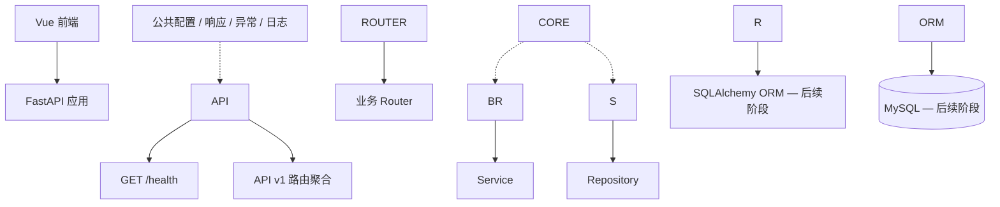

# CampusTrading 后端开发指南

> 适用对象：后端开发成员、前端接口联调成员、测试及部署成员。  
> 适用范围：阶段 1 基础工程与阶段 2 公共基础设施。  
> 本文件应放置于仓库的 `backend/README.md`，不替换仓库根目录 README 或前端 README。

本文说明如何搭建和运行后端工程、使用公共组件、接入业务模块以及执行开发验收。各业务模块的字段、权限、状态流转及正式 API 路径以团队确认的后端规范和接口清单为准。本文件不擅自新增业务需求。

## 目录

* [1. 项目定位与当前范围](#1-项目定位与当前范围)
* [2. 技术栈与环境要求](#2-技术栈与环境要求)
* [3. 工程目录与职责](#3-工程目录与职责)
* [4. 本地环境搭建](#4-本地环境搭建)
* [5. 配置管理](#5-配置管理)
* [6. 应用启动与接口验证](#6-应用启动与接口验证)
* [7. 统一响应封装](#7-统一响应封装)
* [8. 全局异常处理](#8-全局异常处理)
* [9. 日志管理](#9-日志管理)
* [10. CORS 跨域配置](#10-cors-跨域配置)
* [11. API 路由聚合与模块接入](#11-api-路由聚合与模块接入)
* [12. 代码规范与自动化测试](#12-代码规范与自动化测试)
* [13. 依赖版本管理](#13-依赖版本管理)
* [14. Git 协作与提交验收](#14-git-协作与提交验收)
* [15. 常见问题](#15-常见问题)
* [16. 实现边界与后续工作](#16-实现边界与后续工作)

## 1\. 项目定位与当前范围

CampusTrading 为校园综合服务平台。后端采用 FastAPI 模块化单体架构，各业务模块在统一应用内独立组织，不为各模块分别创建服务进程、数据库连接框架或认证框架。

阶段 1 建立独立 Python 环境、最小 FastAPI 应用、依赖清单、Ruff 和 Pytest。阶段 2 在此基础上提供以下公共设施：

|组件|实现位置|功能|
|-|-|-|
|应用组装|`app/main.py`|加载配置，注册公共设施与 API 路由，提供健康检查|
|配置管理|`app/core/config.py`|读取环境变量和 `.env`，校验并缓存配置|
|响应封装|`app/core/response.py`|统一 `code`、`message`、`data`|
|异常处理|`app/core/exceptions.py`|统一业务异常、请求校验异常、HTTP 异常及未知异常的响应|
|日志管理|`app/core/logging.py`|配置应用日志级别、格式及控制台输出|
|跨域管理|`app/core/cors.py`|允许配置中的前端来源访问 API|
|路由聚合|`app/api/v1/router.py`|集中接入各业务模块 Router|
|自动化测试|`tests/`|验证公共组件及基础接口行为|

本阶段尚未实现数据库持久化、完整 JWT 认证、业务接口和生产部署。`db/` 及各业务包是预留模块边界，不代表对应功能已完成。

## 2\. 技术栈与环境要求

|技术|职责|
|-|-|
|Python 3.13.x|后端运行环境；开发基线为 3.13.5|
|FastAPI|Web API 框架、路由、依赖注入、OpenAPI|
|Uvicorn|ASGI 服务|
|Pydantic 2|响应模型及数据校验|
|pydantic-settings|环境变量与配置管理|
|Ruff|静态代码检查、导入排序及格式化|
|Pytest|自动化测试|
|TestClient|FastAPI/Starlette 接口测试；相关 HTTP 客户端依赖以开发清单为准|
|Git / GitHub|版本管理与团队协作|

安装时以仓库提交的 `requirements.txt`、`requirements-dev.txt` 为准，不以本文中的技术名称为安装版本依据。建议使用与负责人一致的 Python 小版本，并在提交依赖变更前验证兼容性。Windows 环境使用 PowerShell；Linux/macOS 的命令在下文另行列出，部署兼容性仍需后续验证。

## 3\. 工程目录与职责

```text
CampusTrading/
├── README.md                     # 仓库总体说明
├── .gitignore                    # 仓库公共忽略规则
├── frontend/                     # 前端工程，由前端成员维护
└── backend/
    ├── README.md                 # 本文件
    ├── .gitignore                # 后端环境配置忽略规则
    ├── .env.example              # 可提交的配置模板
    ├── .env                      # 本地配置，不提交
    ├── .venv/                    # 本地虚拟环境，不提交
    ├── pyproject.toml            # Ruff、Pytest 配置
    ├── requirements.txt          # 生产依赖清单
    ├── requirements-dev.txt      # 完整开发依赖清单
    ├── app/
    │   ├── \_\_init\_\_.py
    │   ├── main.py
    │   ├── api/
    │   │   └── v1/
    │   │       └── router.py
    │   ├── core/
    │   │   ├── config.py
    │   │   ├── response.py
    │   │   ├── exceptions.py
    │   │   ├── logging.py
    │   │   └── cors.py
    │   ├── db/                   # 数据库公共设施，阶段 3 实现
    │   └── modules/
    │       ├── auth/
    │       ├── user/
    │       ├── admin/
    │       ├── product/
    │       ├── lost\_found/
    │       └── errand/
    └── tests/
        ├── test\_health.py
        ├── test\_response.py
        ├── test\_exceptions.py
        ├── test\_config.py
        ├── test\_logging.py
        ├── test\_cors.py
        └── test\_router.py
```

为便于阅读，目录树省略了部分 `\_\_init\_\_.py` 与缓存文件。业务包可根据需求进一步建立 `router.py`、`schema.py`、`service.py`、`repository.py` 和 `model.py`；没有独立持久化需求的模块不强制创建空 Model 或 Repository。



### 3.1 分层边界

|层|负责|不应负责|
|-|-|-|
|Router|路径、请求参数、依赖注入、调用 Service、HTTP 响应|大段业务逻辑、直接操作数据库|
|Schema|输入输出结构、数据类型及字段校验|持久化、数据库事务|
|Service|业务规则、资源权限、业务操作协调；后续统一管理事务|直接依赖 HTTP 请求对象、重复实现全局异常处理|
|Repository|封装 ORM 查询及持久化操作|独立提交业务事务、决定 HTTP 响应|
|Model|ORM 表映射和数据库关系|接口响应封装、业务流程调度|
|Core|全应用共享的配置、响应、异常等基础能力|某个业务模块的专属逻辑|

### 3.2 模块职责与修改范围

|范围|维护责任|
|-|-|
|`app/main.py`、`app/api/`、`app/core/`|后端负责人（成员 7）统一维护或审核|
|`app/db/`、数据库迁移及公共测试|成员 7 与成员 11 协作|
|`modules/auth/`、`modules/user/`|成员 7|
|`modules/product/`|成员 8（二手交易）|
|`modules/lost\_found/`|成员 9（失物招领）|
|`modules/errand/`|成员 10（跑腿服务）|
|`modules/admin/`|按团队确定的管理端职责分工|
|`tests/`|各成员维护自己模块测试，公共测试由负责人协调|

成员不应未经沟通改动其他成员的业务实现或公共契约。涉及公共配置、接口协议、共享模型或数据库迁移的修改，应由相关负责人审核后合并。

## 4\. 本地环境搭建

### 4.1 获取项目

首次下载仓库：

```powershell
git clone https://github.com/ZorraXiao/CampusTrading.git
cd CampusTrading
```

如果普通 HTTPS 克隆出现 `Connection was reset`，可改用：

```powershell
git -c http.version=HTTP/1.1 clone https://github.com/ZorraXiao/CampusTrading.git
```

已有本地仓库时不需要再次克隆。公共基础工程 PR 合并后，从最新 `main` 开始开发；未合并时，需要由负责人协调基于哪个开发分支开展工作，避免从缺少后端基础设施的分支开发。

### 4.2 Windows / PowerShell

以下操作从仓库根目录开始：

```powershell
cd backend
py -3.13 --version
py -3.13 -m venv .venv
.\\.venv\\Scripts\\python.exe -m pip install --upgrade pip
.\\.venv\\Scripts\\python.exe -m pip install -r requirements-dev.txt
.\\.venv\\Scripts\\python.exe -m pip check
```

确认解释器位置：

```powershell
.\\.venv\\Scripts\\python.exe -c "import sys; print(sys.version); print(sys.executable)"
```

解释器应位于当前仓库的 `backend\\.venv\\Scripts\\python.exe`，而不是 Anaconda 全局环境或其他项目环境。

可选：希望使用简短的 `python` 命令时，激活虚拟环境：

```powershell
.\\.venv\\Scripts\\Activate.ps1
```

若 PowerShell 禁止运行脚本，直接使用上述 `.venv` 解释器即可，无须修改系统执行策略。确有激活需求时，可以针对当前终端使用 `Set-ExecutionPolicy -Scope Process -ExecutionPolicy RemoteSigned`，再执行激活命令。


### 4.3 初始化本地配置

在 `backend/` 下执行。已有 `.env` 时保留个人配置，不要覆盖。

Windows：

```powershell
if (-not (Test-Path .env)) { Copy-Item .env.example .env }
```

Linux/macOS：

```bash
test -f .env || cp .env.example .env
```

虚拟环境必须在本机重建。不要从其他项目复制 `.venv`，不要把 `.venv` 上传到 GitHub。

## 5\. 配置管理

统一入口：`app/core/config.py`。

```python
from app.core.config import get\_settings

settings = get\_settings()
print(settings.app\_name)
```

`Settings` 基于 `pydantic-settings.BaseSettings`；`.env` 路径通过 `config.py` 所在位置定位到 `backend/`，因此不依赖终端当前路径。`get\_settings()` 使用 `lru\_cache` 缓存配置对象。

### 5.1 当前配置项

|环境变量|类型|默认值|用途|
|-|-|-|-|
|`APP\_NAME`|str|CampusTrading API|OpenAPI 应用标题|
|`APP\_VERSION`|str|0.1.0|应用版本，不等同于 URL API 版本|
|`APP\_ENV`|Literal|development|允许 development / testing / production|
|`DEBUG`|bool|false|FastAPI 调试模式|
|`API\_V1\_PREFIX`|str|/api/v1|业务接口统一前缀|
|`HOST`|str|127.0.0.1|预留服务监听地址配置|
|`PORT`|int|8000|预留服务监听端口配置|
|`LOG\_LEVEL`|Literal|INFO|允许 DEBUG / INFO / WARNING / ERROR|
|`CORS\_ORIGINS`|list\[str]|本地 5173 端口的两个来源|允许的前端来源列表|

`HOST` 与 `PORT` 已在 Settings 中定义，但当前 Uvicorn CLI 启动方式不会自动读取这两个应用字段；需要改变监听地址或端口时，使用 `--host`、`--port` 显式指定。`APP\_ENV=production` 不会自动关闭 DEBUG 或替换 CORS 白名单，需要显式设置并检查。

当前 `.env.example`：

```dotenv
# Application
APP\_NAME="CampusTrading API"
APP\_VERSION=0.1.0
APP\_ENV=development
DEBUG=false

# API
API\_V1\_PREFIX=/api/v1

# Server
HOST=127.0.0.1
PORT=8000

# Logging
LOG\_LEVEL=INFO

# CORS
CORS\_ORIGINS=\["http://localhost:5173","http://127.0.0.1:5173"]
```

### 5.2 配置使用规则

* 优先使用 `get\_settings()`，不要在各业务模块分别读取 `.env` 或硬编码运行环境。
* 显式构造 Settings 时传入的值优先于系统环境变量；系统环境变量优先于 `.env`，最后使用字段默认值。
* `case\_sensitive=False`；`.env` 中未定义的额外配置项可能触发校验失败（`extra="forbid"`）。新增字段时同时更新 `config.py` 与 `.env.example`。
* `CORS\_ORIGINS` 是 JSON 数组，不使用逗号分隔的普通字符串。
* 修改 `.env` 后重启应用；测试中如需重新读取缓存配置，使用 `get\_settings.cache\_clear()` 并在测试结束后清理。
* `.env.example` 只记录模板与非敏感默认值，真实 `.env` 不提交。后续数据库密码和 JWT 密钥同样不得进入 Git、日志或公开文档。

验证当前阶段的配置（只打印非敏感字段）：

```powershell
.\\.venv\\Scripts\\python.exe -c "from app.core.config import get\_settings; s=get\_settings(); print(s.app\_name, s.app\_env, s.api\_v1\_prefix, s.log\_level)"
```

## 6\. 应用启动与接口验证

所有以下命令均在 `backend/` 下执行。

Windows：

```powershell
.\\.venv\\Scripts\\python.exe -m uvicorn app.main:app --reload --host 127.0.0.1 --port 8000
```

Linux/macOS：

```bash
.venv/bin/python -m uvicorn app.main:app --reload --host 127.0.0.1 --port 8000
```

其中 `app.main:app` 表示从 `app/main.py` 导入名为 `app` 的 ASGI 应用；`--reload` 仅用于开发环境。按 `Ctrl+C` 停止服务。

|入口|地址|说明|
|-|-|-|
|健康检查|[http://127.0.0.1:8000/health](http://127.0.0.1:8000/health)|当前应用存活检查|
|Swagger UI|[http://127.0.0.1:8000/docs](http://127.0.0.1:8000/docs)|交互式接口文档|
|OpenAPI|[http://127.0.0.1:8000/openapi.json](http://127.0.0.1:8000/openapi.json)|接口定义 JSON|

PowerShell 也可以直接验证：

```powershell
Invoke-RestMethod http://127.0.0.1:8000/health | ConvertTo-Json -Depth 5
```

期望 HTTP 200 与如下响应：

```json
{
  "code": "SUCCESS",
  "message": "ok",
  "data": {"status": "ok"}
}
```

`/health` 只验证当前应用能处理请求，不代表数据库、认证或业务功能正常。`/docs` 和 `/openapi.json` 是框架技术入口，不要求使用业务响应封装。业务接口统一使用 `/api/v1`，`/health` 为技术例外。

## 7\. 统一响应封装

统一入口：`app/core/response.py`。

|公共对象|用途|
|-|-|
|`ApiResponse\[T]`|Pydantic 泛型响应模型，描述 `data` 类型|
|`success\_response(data=None, message="ok")`|构造成功响应，`code` 固定为 `SUCCESS`|
|`error\_response(code, message)`|构造错误响应对象，`data` 为 `None`|

统一业务响应的顶层字段只有 `code`、`message`、`data`。HTTP 状态码由路由或异常处理器决定，不能仅通过响应体中的 `code` 替代真实 HTTP 状态。

### 7.1 成功响应示例

```python
from app.core.response import success\_response

response = success\_response(data={"id": "1", "name": "Example"})
```

```json
{
  "code": "SUCCESS",
  "message": "ok",
  "data": {"id": "1", "name": "Example"}
}
```

无返回数据时使用 `success\_response()`，响应中的 `data` 为 `null`。需要返回 HTTP 201 的创建接口，应由 Router 的 `status\_code` 声明设置，不能依赖 `success\_response()` 自动改变 HTTP 状态。

### 7.2 Router 响应模型

正式业务接口推荐定义具体的输出 Schema，并声明 `response\_model=ApiResponse\[具体Schema]`。例如：

```python
from fastapi import APIRouter
from pydantic import BaseModel

from app.core.response import ApiResponse, success\_response

router = APIRouter()


class ExampleOut(BaseModel):
    id: str
    name: str


@router.get("/example", response\_model=ApiResponse\[ExampleOut])
def get\_example():
    return success\_response(data=ExampleOut(id="1", name="Example"))
```

此处是教学示例，不是已注册业务接口，不应直接加入正式路由。实际 Schema 与路径以接口规范为准。

### 7.3 响应约束

* `code` 是稳定的大写英文业务码，前端按 `code` 和 HTTP 状态处理，不依赖人类可读的 `message` 做业务判断。
* `data` 承载业务数据；错误通常为 `null`，请求校验错误是例外，包含安全的字段错误列表。
* 不自行新增 `success`、`status`、`msg` 等顶层字段，不套用第二层统一响应。
* 输出应使用明确的 Schema，不能直接暴露包含密码哈希等内部字段的 ORM 对象。
* 按既定接口约定，业务 ID 对外使用十进制字符串；分页数据放在 `data` 中，结构为 `page`、`page\_size`、`total`、`items`，具体接口以后续正式实现为准。

## 8\. 全局异常处理

统一入口：`app/core/exceptions.py`。`main.py` 已通过 `register\_exception\_handlers(app)` 注册处理器；业务成员无须自行注册同类全局异常处理器。

### 8.1 业务异常 AppError

在 Service 或 Router 中，当业务规则不满足时抛出 `AppError`：

```python
from app.core.exceptions import AppError


def ensure\_product\_exists(product):
    if product is None:
        raise AppError(
            code="PRODUCT\_NOT\_FOUND",
            status\_code=404,
            message="Product not found",
        )
    return product
```

上述业务码是使用示例；实际资源错误码以模块接口规范为准。

处理器返回 HTTP 404：

```json
{
  "code": "PRODUCT\_NOT\_FOUND",
  "message": "Product not found",
  "data": null
}
```

`error\_response()` 只构造响应体；业务异常优先抛出 `AppError`，而不是在业务代码中 `return error\_response(...)`，否则可能误返回 HTTP 200。

### 8.2 当前异常处理行为

|异常类别|处理方式|
|-|-|
|`AppError`|使用异常指定的 `status\_code`、`code`、`message`|
|`RequestValidationError`|HTTP 422，`VALIDATION\_ERROR`，仅返回字段定位和错误类型|
|Starlette `HTTPException`|保留原 HTTP 状态和异常 headers，根据状态映射错误码|
|未知 `Exception`|在非调试模式下返回 HTTP 500、`INTERNAL\_ERROR`，不在响应体暴露内部异常消息|

HTTP 异常映射如下；业务 `AppError` 可以使用接口规范约定的更具体的错误码。

|HTTP 状态|当前通用错误码|使用场景|
|-|-|-|
|400|`BAD\_REQUEST`|请求语义不成立|
|401|`UNAUTHENTICATED`|身份认证失败（具体认证逻辑后续实现）|
|403|`FORBIDDEN`|权限不足|
|404|`NOT\_FOUND`|路径或资源不存在|
|405|`METHOD\_NOT\_ALLOWED`|请求方法不支持|
|409|`CONFLICT`|重复操作或状态冲突|
|422|`VALIDATION\_ERROR`|请求结构或类型校验失败|
|429|`TOO\_MANY\_REQUESTS`|请求过多（当前没有实现限流器）|
|500|`INTERNAL\_ERROR`|服务器内部错误|
|其他未映射状态|`HTTP\_ERROR`|通用 HTTP 异常|

请求校验失败示例（如将 `quantity` 的整数参数传入字符串 `abc`）：

```json
{
  "code": "VALIDATION\_ERROR",
  "message": "Request validation failed",
  "data": {
    "errors": \[
      {"loc": \["query", "quantity"], "type": "int\_parsing"}
    ]
  }
}
```

上例为典型 Pydantic 校验结果，具体 `loc`、`type` 随请求字段与校验规则变化。不要将完整请求体、原始输入或异常上下文返回客户端。

### 8.3 异常使用约束

* 不要捕获所有异常后返回成功响应，不要使用 HTTP 200 表示业务失败。
* `AppError` 的 `message` 必须是可公开的安全信息；不能把内部异常字符串直接传给它。
* HTTP 异常的 `detail` 同样只能传入可公开信息，当前处理器会将非 5xx 的 `detail` 转为字符串。
* 401 的 Bearer challenge 等响应头在后续认证实现时明确提供；当前通用 HTTP 异常处理器只保留原有 headers，不自动完成认证协议。
* 当前数据库异常尚未分类；阶段 3 仅对明确识别的唯一约束等冲突返回 409，不应将所有数据库错误转换成 409。
* 生产运行必须保持 `DEBUG=false`。开启 FastAPI 调试模式时，未知异常可能由框架返回调试信息而不是统一 500 JSON。

## 9\. 日志管理

统一入口：`app/core/logging.py`。`main.py` 调用 `configure\_logging(settings.log\_level)`，使用 Python 标准库 `logging.config.dictConfig` 设置根记录器。

业务模块使用方式：

```python
import logging

logger = logging.getLogger(\_\_name\_\_)


def record\_operation(product\_id: str) -> None:
    logger.info("Product operation completed: product\_id=%s", product\_id)
```

推荐输出形式：`时间 | 级别 | 模块名 | 消息`。

|级别|建议用途|
|-|-|
|DEBUG|开发期间的诊断信息|
|INFO|正常启动、关键操作完成|
|WARNING|可处理的异常情况|
|ERROR|执行失败或系统异常|
|CRITICAL|重大服务故障|

禁止记录明文密码、JWT、Cookie、认证请求原文、数据库连接凭据、完整用户隐私数据等敏感信息。日志参数采用 logging 的参数化写法，不在公共组件之外重复设置根 logger。

当前仅配置应用控制台日志，不统一覆盖 Uvicorn 访问日志，不提供文件轮转、集中日志、审计日志或请求追踪 ID。未知异常处理器当前仅记录异常类型；Uvicorn 等服务器自身的异常输出仍须在部署阶段检查和配置脱敏。

## 10\. CORS 跨域配置

统一入口：`app/core/cors.py`。`configure\_cors(app, settings)` 向 FastAPI 注册 `CORSMiddleware`。

当前默认允许的前端来源为 `http://localhost:5173`、`http://127.0.0.1:5173`。来源由协议、主机、端口共同确定，两者是不同 Origin。

|项目|当前配置|
|-|-|
|Origins|`settings.cors\_origins`|
|Methods|GET、POST、PUT、PATCH、DELETE、OPTIONS|
|Headers|Authorization、Content-Type|
|Credentials|False；当前按 JWT Bearer 方案设计，不依赖跨域 Cookie|

前端地址改变时，更新本地 `.env` 的 `CORS\_ORIGINS` 并重启后端。例如：

```dotenv
CORS\_ORIGINS=\["http://localhost:5173","http://127.0.0.1:5173","http://localhost:3000"]
```

不要在生产环境使用 `\*` 代替来源白名单。默认配置仅适用于本地开发，生产部署需配置实际前端来源。CORS 不等同于身份认证或访问控制；非法 Origin 的普通 HTTP 请求仍可能由后端处理，但浏览器不会允许前端脚本读取未授权的跨域响应。当前预检响应由中间件处理，不使用业务 JSON 封装；对于未捕获的 500 响应是否带 CORS 头还需要额外集成测试，不能将普通 CORS 测试通过理解为所有错误场景均已覆盖。

## 11\. API 路由聚合与模块接入

`app/api/v1/router.py` 统一定义 `api\_router = APIRouter()`；`main.py` 通过以下方式注册：

```python
app.include\_router(api\_router, prefix=settings.api\_v1\_prefix)
```

目前聚合 Router 尚未注册正式业务接口。因此 `/api/v1` 本身并不必然是一个可访问接口，访问返回 404 属于正常情况。

### 11.1 新业务模块的接入流程

以二手交易模块为例（路径仅演示注册方式，不确定正式接口）：

1. 在 `app/modules/product/` 内实现 `router.py`、`schema.py`、`service.py` 等必要文件。
2. 模块 `router.py` 导出 `router`，只声明相对于模块的路径。
3. 提交模块测试，由后端负责人统一审核并在 `app/api/v1/router.py` 接入。
4. 启动服务，通过 `/docs` 验证接口，并完成路由与业务测试。

模块 Router 示例：

```python
# app/modules/product/router.py（仅示例）
from fastapi import APIRouter

from app.core.response import ApiResponse, success\_response

router = APIRouter()


@router.get("/example", response\_model=ApiResponse\[dict\[str, str]])
def example():
    return success\_response(data={"status": "ok"})
```

聚合注册示例：

```python
# app/api/v1/router.py（模块真实完成后再接入）
from fastapi import APIRouter

from app.modules.product.router import router as product\_router

api\_router = APIRouter()
api\_router.include\_router(product\_router, prefix="/products", tags=\["Products"])
```

在默认 API 前缀下，上述示例最终路径为 `/api/v1/products/example`。前缀只在负责的层级声明一次，模块 Router 不再重复添加 `/api/v1` 或 `/products`。真实接口必须采用正式 API 清单中的路径、方法、Schema 与权限要求，不能将示例接口作为业务功能提交。

### 11.2 开发约束

* Router 调用 Service；Service 协调 Repository；Repository 使用 ORM。不要在 Router 中直接执行数据库查询。
* 模块内优先使用明确的绝对导入路径（如 `from app.core.response import success\_response`）。
* 不为各模块创建独立 FastAPI 应用或重新配置公共中间件、异常处理器。
* 未完成的模块不要在聚合 Router 中提前 import，以免整个应用无法启动。
* 不跨模块直接操作其他模块的 Repository 或 ORM；跨模块依赖与共享身份模型按正式规范审核。
* 业务认证和资源所有权检查在后续公共认证与业务规则确定后落实，不以临时绕过认证的方式实现正式接口。

## 12\. 代码规范与自动化测试

统一配置文件：`pyproject.toml`。当前配置：

```toml
\[tool.ruff]
target-version = "py313"
line-length = 100

\[tool.ruff.lint]
select = \["E4", "E7", "E9", "F", "I"]

\[tool.pytest.ini\_options]
testpaths = \["tests"]
pythonpath = \["."]
addopts = "-ra"
```

Ruff 当前启用基础语法/错误检查、Pyflakes 和导入排序规则，格式化目标行宽 100。未启用完整类型检查或所有风格规则，不能把 Ruff 通过理解为业务正确或完整安全审查通过。

### 12.1 Windows 常用命令

在 `backend/` 执行：

```powershell
# 自动格式化
.\\.venv\\Scripts\\python.exe -m ruff format .

# 静态检查（必要时可用 --fix 修复可自动处理的问题）
.\\.venv\\Scripts\\python.exe -m ruff check .

# 只检查格式，不修改文件
.\\.venv\\Scripts\\python.exe -m ruff format --check .

# 全量测试
.\\.venv\\Scripts\\python.exe -m pytest -q

# 详细测试输出
.\\.venv\\Scripts\\python.exe -m pytest -v

# 仅运行某个测试文件
.\\.venv\\Scripts\\python.exe -m pytest tests/test\_response.py -v

# 依赖完整性检查
.\\.venv\\Scripts\\python.exe -m pip check
```

Linux/macOS 对应命令使用 `.venv/bin/python` 替代 `.\\.venv\\Scripts\\python.exe`。

### 12.2 公共设施测试清单

|文件|预期用例数|验证范围|
|-|-:|-|
|`test\_health.py`|1|健康检查状态码与完整响应|
|`test\_response.py`|3|成功、有/无数据、错误响应|
|`test\_exceptions.py`|4|业务异常、参数校验、HTTP 异常、未知异常脱敏响应|
|`test\_logging.py`|1|日志配置字典及级别|
|`test\_cors.py`|3|允许来源、非白名单来源、预检请求|
|`test\_router.py`|3|Router 存在、前缀机制、根路径健康检查|
|`test\_config.py`|3|默认配置、环境变量覆盖、非法环境值|
|**合计**|**18**|**阶段 2 公共测试基线**|

测试数量按阶段 2 的实现方案统计；后续增加测试时应同步更新清单，不将固定数量作为长期验收标准。路由前缀测试使用独立测试应用，日志测试验证配置生成，尚不等同于完整的真实业务路由、生产日志或数据库集成测试。

### 12.3 测试编写要求

* 文件命名 `test\_\*.py`，测试函数命名 `test\_\*`，避免将非测试的 FastAPI 应用实例命名为 `test\_app`，以免 Pytest 误收集。
* API 测试使用 `fastapi.testclient.TestClient`；测试中构建的临时路由不得注册进正式应用。
* 测试 HTTP 500 的响应内容时，使用 `TestClient(app, raise\_server\_exceptions=False)`，否则服务器异常可能直接传播给测试。
* 配置测试使用 `Settings(\_env\_file=None)`、`monkeypatch` 隔离本地 `.env` 与相关环境变量。
* 正常、异常、边界及权限场景均应覆盖；在数据库阶段增加真实事务及迁移测试。
* 断言同时验证 HTTP 状态码与业务响应，敏感信息不得泄露。不能删除有效测试或放宽断言来掩盖失败。
* 新增模块及修改公共组件后运行全量测试，而不是只运行自己的测试。

## 13\. 依赖版本管理

|文件|内容|使用者|
|-|-|-|
|`requirements.txt`|锁定的生产运行依赖及传递依赖|生产运行环境|
|`requirements-dev.txt`|完整开发依赖，包含生产依赖与测试、格式化工具|开发和测试成员|

日常开发安装 `requirements-dev.txt` 即可。生产环境只安装 `requirements.txt`，但部署方式与平台适配需在后续阶段验收。

依赖版本由负责人统一维护。新增依赖先说明用途，并验证 `pip check`、Ruff 和 Pytest；不应随意使用 `pip install --upgrade` 批量升级业务依赖。阶段 2 新增 `pydantic-settings`，必须同时进入生产和开发依赖清单。

在当前虚拟环境确认依赖及测试通过后，更新开发清单（Windows）：

```powershell
.\\.venv\\Scripts\\python.exe -m pip freeze | Set-Content -Encoding ascii requirements-dev.txt
```

生产依赖清单应从干净的纯生产虚拟环境生成，使用已确认的直接运行依赖及与开发清单一致的版本约束；不直接将完整开发环境的 `pip freeze` 复制成生产清单。更新后验证全新环境可以安装两份清单、导入 `app.main` 并运行对应测试。PowerShell 5.1 使用 `Set-Content -Encoding ascii` 可避免 `>` 将普通依赖文本保存为 UTF-16。若未来依赖包含非 ASCII 内容，应使用适当的 UTF-8 文本编码。

锁定清单不包含 `.venv` 本身，也不是跨平台兼容性的保证。新增依赖时应检查 Linux 部署环境是否可安装，必要时统一维护平台条件或专用锁定方案。

## 14\. Git 协作与提交验收

仓库：[https://github.com/ZorraXiao/CampusTrading](https://github.com/ZorraXiao/CampusTrading)。

原则：`main` 保持为团队共同基线；独立功能分支用于开发，PR 用于审核。阶段 1 和阶段 2 分别在 `feature/backend-bootstrap` 和 `feature/backend-core` 开发。开发分支不是独立后端目录，合并后的代码都位于同一个 `backend/`。

## 

